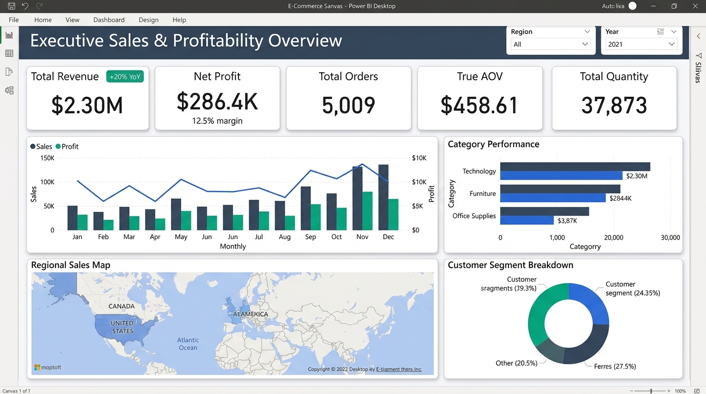
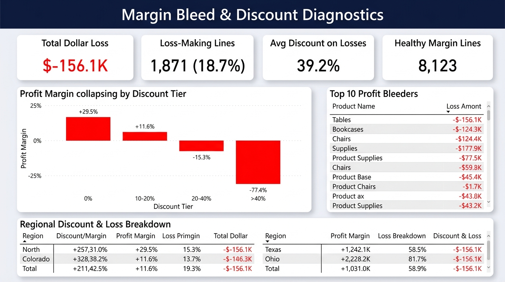

# Sales Performance & E-Commerce Analytics (MySQL + Power BI)

[](https://www.mysql.com/)
[](https://powerbi.microsoft.com/)
[-3776AB.svg)](https://www.python.org/)
[](https://opensource.org/licenses/MIT)

An end-to-end business intelligence and data analytics project modeling 4 years of retail transactional data ($2.30M in revenue, $286.4K in net profit). Covers the full data lifecycle: **data quality auditing & cleaning &rarr; relational schema design & indexing in MySQL 8.0 &rarr; complex business queries (CTEs, Window Functions) &rarr; Star Schema dimensional modeling & DAX &rarr; interactive executive reporting in Power BI**.

---

## 1. Business Problem & Objectives

Executive leadership at a major retail e-commerce enterprise observed that despite strong revenue expansion across four consecutive years, **bottom-line net margin remained compressed at 12.47%**. Furthermore, several high-volume sales regions and product lines appeared to consume disproportionate capital without contributing profit.

### Key Business Questions Addressed:
1. **Commercial Health**: What are our true top-line revenue, bottom-line profit, and order-level Average Order Value (AOV)?
2. **Growth Trajectory**: How are sales and profit trending on a Month-over-Month (MoM) and Year-over-Year (YoY) basis?
3. **Discount Sensitivity**: At what discount percentage does promotional discounting destroy profitability?
4. **Geographic Margin Leaks**: Why do high-revenue states like Texas ($170K sales) generate heavy net financial losses (-$25.7K)?
5. **Product Portfolio Health**: Which sub-categories and SKUs are primary "profit bleeders", and what operational policies should be enforced?

---

## 2. Tech Stack & Architecture

```
+--------------------------------+       +-----------------------------------+       +---------------------------------+
|      Data Source & Audit       |       |     Relational Database (MySQL)   |       |       Business Intelligence     |
| - Sample Superstore Dataset    | ----> | - 3 Normalized Tables             | ----> | - Star Schema Data Model        |
| - Python Pandas Audit Pipeline |       | - Primary & Foreign Key Indexes   |       | - 15+ Advanced DAX Measures     |
| - Data Hygiene & Date Normaliz.|       | - 10 Core Analytical SQL Queries  |       | - 2-Page Executive Dashboard    |
+--------------------------------+       +-----------------------------------+       +---------------------------------+
```

- **Data Inspection & Cleaning**: Python 3.10 (Pandas), Microsoft Excel
- **Relational Database**: MySQL Server 8.0 (InnoDB engine, B-Tree indexes, CTEs, Window Functions)
- **Business Intelligence**: Power BI Desktop (VertiPaq In-Memory engine, Star Schema, DAX Time Intelligence)

---

## 3. Dataset Overview & Data Quality Audit

- **Dataset**: Tableau Sample Superstore (Benchmark Retail Sales Dataset)
- **Primary Source**: [Tableau Community Sample Data](https://community.tableau.com/s/sample-data) | [Kaggle Mirror](https://www.kaggle.com/datasets/bravehart101/sample-superstore-dataset)
- **Transaction Order Lines**: 9,994 rows
- **Distinct Orders**: 5,009 unique customer checkout orders
- **Time Span**: 4 consecutive operating years
- **Geographic Coverage**: 531 cities across 49 US States

### Real-World Data Hygiene Discoveries:
1. **Multi-Sheet Concatenation Anomaly**: The raw CSV contained 806 trailing rows with NULL dates. Investigation revealed that three separate Excel sheets (`Orders`, `People`, `Returns`) were vertically merged into one file. An automated script isolated the 9,994 order records, 4 regional manager mappings, and 296 returned order records.
2. **Missing Postal Codes**: Exactly 11 rows had NULL postal codes, all corresponding to Burlington, Vermont. Imputed official zip code `05408` as string format to preserve leading zeros.
3. **Order Lines vs. Duplicate Orders**: Recognised that repeated `order_id` values represent legitimate multi-item transactions (average basket size: 2.0 items/order), avoiding erroneous deletion of 4,985 valid purchase lines.
4. **Date Integrity**: Verified that 100% of rows satisfied `ship_date >= order_date`, with an average shipping lead time of 3.96 days across standard, second, first, and same-day shipping tiers.

---

## 4. Repository Structure

```
sales-performance-ecommerce-analytics/
├── data/
│   ├── raw/
│   │   ├── Sample_Superstore_raw.csv   # Original downloaded dataset
│   │   └── README.md                   # Sourcing and download guide
│   └── processed/
│       ├── cleaned_superstore.csv      # Cleansed dataset (9,994 rows, ISO dates)
│       ├── superstore_people.csv       # Extracted regional managers
│       └── superstore_returns.csv      # Extracted 296 returned orders
├── sql/
│   ├── 01_schema_setup.sql             # Database DDL, table schema, and index definitions
│   ├── 02_data_cleaning.sql            # Data hygiene audits, duplicate tests, integrity checks
│   └── 03_business_queries.sql         # 10 core business analysis queries (CTEs, Window functions)
├── power_bi/
│   ├── dax_measures.txt                # Documented DAX formulas with display folders
│   ├── dashboard_design_guide.md       # Layout wireframes, visual matrix, palette, step-by-step build guide
│   └── data_model_star_schema.md       # Star schema modeling and DAX Calendar table script
├── scripts/
│   ├── download_or_generate.py         # Automated data download, audit, and preparation script
│   └── load_to_mysql.py                # Database loader tool with connection error handling
├── docs/
│   ├── data_dictionary.md              # Column-level data dictionary and constraints
│   ├── interview_prep.md               # 10 interview questions with SQL/DAX/business answers
│   └── resume_bullets.md               # Verifiable resume bullet points for 2026 freshers
└── README.md                           # GitHub-ready project presentation
```

---

## 5. Setup & Execution Guide

### Step 1: Environment Setup & Data Pipeline
Clone the repository and run the automated data preparation script:
```bash
# Clone repository
git clone https://github.com/priyakp08/sales-performance-ecommerce-analytics.git
cd sales-performance-ecommerce-analytics

# Run data audit and cleaning pipeline
python scripts/download_or_generate.py
```

### Step 2: MySQL Database Initialization
1. Open MySQL Workbench or your terminal:
```bash
mysql -u root -p < sql/01_schema_setup.sql
```
2. Import `data/processed/cleaned_superstore.csv` using MySQL Workbench **Table Data Import Wizard** or execute `LOAD DATA INFILE` (detailed in `01_schema_setup.sql`).
3. Run data hygiene queries:
```bash
mysql -u root -p ecommerce_sales_db < sql/02_data_cleaning.sql
```
4. Execute the business analysis queries:
```bash
mysql -u root -p ecommerce_sales_db < sql/03_business_queries.sql
```

### Step 3: Power BI Desktop Setup
1. Launch **Power BI Desktop** &rarr; Select **Get Data &rarr; MySQL database** (or **Text/CSV** pointing to `cleaned_superstore.csv`).
2. Follow [data_model_star_schema.md](power_bi/data_model_star_schema.md) to generate the `DimDate` calendar table and establish 1-to-many single-direction relationships.
3. Import the DAX measures from [dax_measures.txt](power_bi/dax_measures.txt).
4. Follow [dashboard_design_guide.md](power_bi/dashboard_design_guide.md) to construct the 2-page report visuals.

---

## 6. Key Business Metrics & Calculations

| Metric | Business Definition | Technical Formula / DAX | Verified Value |
| :--- | :--- | :--- | :--- |
| **Total Revenue** | Gross invoiced sales across all orders | `SUM(superstore_orders[sales])` | **$2,297,200.86** |
| **Total Profit** | Cumulative net profit after COGS & freight | `SUM(superstore_orders[profit])` | **$286,397.02** |
| **Profit Margin %** | Share of revenue retained as profit | `DIVIDE([Total Profit], [Total Sales], 0)` | **12.47%** |
| **Total Orders** | Unique customer checkout transactions | `DISTINCTCOUNT(superstore_orders[order_id])` | **5,009 orders** |
| **True AOV** | Average revenue per distinct checkout basket | `DIVIDE([Total Sales], [Total Orders], 0)` | **$458.61** |
| **Basket Depth** | Average product items purchased per order | `DIVIDE([Total Order Lines], [Total Orders], 0)` | **2.00 items** |
| **Loss Volume** | Unprofitable transaction line count | `CALCULATE(COUNTROWS(), profit < 0)` | **1,871 lines (18.7%)** |
| **Cumulative Loss** | Total dollar loss incurred by loss-making rows | `CALCULATE(SUM(profit), profit < 0)` | **-$156,131.29** |

---

## 7. Core SQL Analytical Highlights

### 1. MoM Revenue Growth using CTE & `LAG()`
```sql
WITH monthly_sales AS (
    SELECT 
        DATE_FORMAT(order_date, '%Y-%m') AS order_year_month,
        ROUND(SUM(sales), 2) AS monthly_revenue
    FROM superstore_orders
    GROUP BY DATE_FORMAT(order_date, '%Y-%m')
)
SELECT 
    order_year_month,
    monthly_revenue,
    LAG(monthly_revenue, 1) OVER (ORDER BY order_year_month) AS prior_month_revenue,
    ROUND(
        ((monthly_revenue - LAG(monthly_revenue, 1) OVER (ORDER BY order_year_month)) 
        / LAG(monthly_revenue, 1) OVER (ORDER BY order_year_month)) * 100, 2
    ) AS mom_growth_pct
FROM monthly_sales;
```

### 2. Discount Sensitivity Analysis (The Profit Tipping Point)
```sql
SELECT 
    CASE 
        WHEN discount = 0 THEN '0% (No Discount)'
        WHEN discount > 0 AND discount <= 0.10 THEN '0.01% - 10%'
        WHEN discount > 0.10 AND discount <= 0.20 THEN '10.01% - 20%'
        WHEN discount > 0.20 AND discount <= 0.40 THEN '20.01% - 40%'
        ELSE 'Over 40% (Deep Discount)'
    END AS discount_tier,
    COUNT(*) AS total_order_lines,
    ROUND(SUM(sales), 2) AS total_sales,
    ROUND(SUM(profit), 2) AS total_profit,
    ROUND((SUM(profit) / SUM(sales)) * 100, 2) AS profit_margin_pct
FROM superstore_orders
GROUP BY discount_tier
ORDER BY MIN(discount) ASC;
```

---

## 8. Verified Analytical Findings

1. **The 20% Discount Cliff**:
   - At 0% discount: **+29.51% profit margin** ($321K profit).
   - At 10–20% discount: **+11.58% profit margin** ($91.8K profit).
   - At 20–40% discount: Margins turn negative to **-15.30%** (-$35.8K loss).
   - At >40% discount: Margins collapse to **-77.40%** (-$99.6K loss).
   - **Conclusion**: Over 84% of all dollar losses are concentrated in transactions with discounts greater than 20%.

2. **Regional Margin Destruction in Texas, Ohio, and Pennsylvania**:
   - **California** and **New York** generate +$76.4K and +$74.0K in profit with modest average discounts of 7.3% and 5.5%.
   - In contrast, **Texas** generated $170.2K in sales (3rd largest state by volume) but lost **-$25,729** due to an average discount rate of **37.0%**.
   - **Ohio** lost -$16,971 (-21.7% margin) with average discounts of **32.5%**.

3. **Sub-Category Profit Bleeders**:
   - **Tables**: -$17,725.48 net loss (-8.56% margin) despite generating $206,965.53 in sales.
   - **Bookcases**: -$3,472.56 net loss (-3.02% margin).
   - **Supplies**: -$1,189.10 net loss (-2.55% margin).
   - In contrast, **Copiers** and **Phones** delivered healthy margins of +32.3% and +13.3%.

---

## 9. Power BI Interactive Dashboard

The dashboard is structured into a clean, restrained 2-page report engineered for executive review:

### Page 1: Executive Sales & Profitability Performance


- **Top KPI Cards**: Total Revenue ($2.30M), Net Profit ($286.4K), Profit Margin (12.5%), Total Orders (5,009), True AOV ($458.61).
- **Monthly Trajectory**: Dual-axis visual illustrating sales volume growth and margin fluctuations.
- **Geographic & Category Matrix**: Highlighting regional profit leaders (West & East) vs underperformers (Central).

### Page 2: Margin Bleed & Discount Diagnostics


- **Discount Tier Margin Curve**: Visualizing the cliff drop from +29.5% to -77.4% margin.
- **Top 10 Profit Bleeders**: Actionable table identifying SKUs with four-figure losses.
- **State-Level Profit Disparity**: Highlighting regional discounting practices.

---

## 10. Strategic Business Recommendations

1. **Automated ERP Discount Caps**: Implement a hard ceiling preventing field sales reps from applying discounts greater than 20% without regional VP approval.
2. **Revise Regional Compensation**: Shift sales incentives from gross revenue volume to net margin contribution, directly addressing excessive discounting in Texas and Ohio.
3. **Freight & Packaging Surcharges for Heavy Furniture**: Restructure shipping policies for bulky sub-categories (Tables and Bookcases) from subsidized delivery to weight-based freight surcharges.

---

## 11. Project Limitations

1. **Lack of Marketing Acquisition Cost (CAC)**: The dataset does not include ad spend, preventing full Customer Lifetime Value (LTV) to CAC ratio modeling.
2. **Pre-allocated Freight Costs**: Shipping costs are embedded in gross profit rather than broken out as individual freight line items.
3. **Static Tax Rates**: Sales figures represent gross invoiced totals without state-level sales tax variations.

---

## 12. Author & Portfolio Contact
- **Project Lead**: Junior Data Analyst Portfolio
- **Target Role**: Data Analyst / BI Analyst (2026 Graduate)
- **Documentation**: [Data Dictionary](docs/data_dictionary.md) | [Interview Q&A](docs/interview_prep.md) | [Resume Description](docs/resume_bullets.md)
